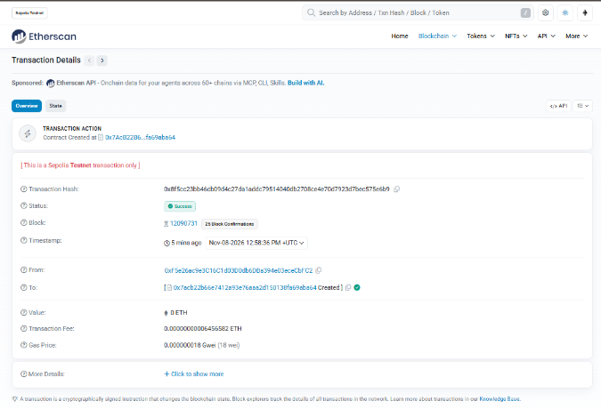

# Deepfake Detection and AI-Generated Media Verification Using Blockchain

A project to explore detecting deepfakes and verifying AI-generated media with machine learning and blockchain.

## Week 1 summary

Completed notebooks and key findings:

- `day2_numpy_pandas.ipynb` — the six example files are balanced: 3 real and 3 fake.
- `day3_matplotlib_eda.ipynb` — the digits dataset has 1,797 images across 10 classes, with pixel values from 0 to 16.
- `day4_overfitting.ipynb` — the unrestricted decision tree reached 1.00 training accuracy and 0.825 test accuracy; logistic regression reached 0.958 test accuracy.
- `day5_metrics.ipynb` — the breast-cancer classifier reached ROC-AUC 0.9937; raising the threshold from 0.3 to 0.9 increased precision from 0.9342 to 1.0000 while recall fell from 0.9861 to 0.7500.
- `day6_first_neural_net.ipynb` — the neural network has 9,610 trainable parameters; the best tested learning rate (0.1) reached 0.9639 test accuracy.
- `day7_first_cnn.ipynb` — on Fashion-MNIST, the MLP reached 0.8747 test accuracy with 101,770 parameters, while the CNN reached 0.9007 with 20,490 parameters; Shirt was the CNN's weakest-recall class at 0.67.

## Dataset audit

The Week 3 Day 15 audit is in `notebooks/week3/day15_faces_eda.ipynb`. Place the faces dataset outside the repository, preserving the `{train,valid,test}/{real,fake}` directory layout, and point `DATASET_ROOT` in the notebook's first code cell to that location. The audit reads images in place; it does not copy or modify them.

| Split | Real | Fake | Total | Balance |
|---|---:|---:|---:|---|
| Train | 50,000 | 50,000 | 100,000 | 50% / 50% |
| Valid | 10,000 | 10,000 | 20,000 | 50% / 50% |
| Test | 10,000 | 10,000 | 20,000 | 50% / 50% |

In a seeded sample of 2,000 images per split, all images were 256 × 256 RGB; no sampled files were unreadable or non-RGB. No filename was shared across splits. MD5 comparison of a random sample of 500 images per split found no cross-split hash matches (sampled-content check, not an exhaustive hash audit).

## Transfer learning smoke test

The Week 3 Day 16 CPU smoke test is in `notebooks/week3/day16_efficientnet_transfer.ipynb`. It uses ImageNet-pretrained EfficientNet-B0 (4,010,110 total parameters), first training the classifier head and then fine-tuning the last two feature blocks. The measured train-epoch times were 124.3 s and 88.1 s in feature-extraction phase 1, and 88.4 s in fine-tuning phase 2. At the observed mixed-phase rate, projected times are 8.4 minutes for one 10,000-image epoch and 83.6 minutes for one 100,000-image epoch.

These are CPU smoke-test results, not final model results. On a stratified 500-image test subset, accuracy was 0.8060; fake-class precision, recall, and F1 were 0.8048, 0.8080, and 0.8064; ROC-AUC using P(fake) was 0.8961. The confusion matrix (true rows and predicted columns ordered fake, real) was `[[202, 48], [49, 201]]`. The smoke-test weights are saved to the Git-ignored `models/effnet_b0_smoke.pth`.

## Running the app

Install the project requirements, then start the FastAPI backend and Streamlit interface in separate terminals from the project root:

```bash
uvicorn app.main:app --reload
streamlit run app/ui.py
```

By default, the backend loads `models/effnet_b0_smoke.pth` on CPU. Set `MODEL_WEIGHTS` to another compatible EfficientNet-B0 state-dict path to use a different model without changing code. The UI sends requests to `http://127.0.0.1:8000` by default; set `API_URL` to change the backend address. The detector was trained on StyleGAN faces only and may fail on images from other generators.

## Blockchain provenance

The Stage B provenance layer stores only the uploaded file's SHA-256 digest, fake/real verdict, fake score, registrar, and registration time in the `MediaRegistry` contract. The image remains off-chain and is never sent to or stored by the contract. The FastAPI endpoints can register an analysis with `/analyze` and check a file's exact-byte hash with `/verify`; a modified file produces a different hash.

By default, the API uses an in-memory `eth-tester` chain. Its registry and records are ephemeral and reset whenever the API server restarts, so register and verify within the same running server process. `scripts/verify_stage_b.py` exercises compilation, registration, exact-copy verification, a one-pixel tamper check, duplicate-registration rejection, and the API endpoints.

### Sepolia deployment

`MediaRegistry` is deployed to Sepolia at [`0x7AcB22B66E7412A93E76AaA2d150138fa69aba64`](https://sepolia.etherscan.io/address/0x7AcB22B66E7412A93E76AaA2d150138fa69aba64). Its ABI and address are stored in `contracts/deployment_sepolia.json`.

The deployment transaction succeeded on Sepolia:



To connect the app to Sepolia, set these values in a local, Git-ignored `.env` file:

```dotenv
RPC_URL=<your Sepolia JSON-RPC endpoint>
PRIVATE_KEY=<your Sepolia deployer private key>
CONTRACT_ADDRESS=<deployed MediaRegistry address>
```

The app loads `.env` at startup. When both `RPC_URL` and `PRIVATE_KEY` are configured, the client checks for Sepolia chain ID `11155111` and signs transactions with the configured account; without them it uses the local in-memory `eth-tester` chain. Keep `.env` private and never commit it. The deployment script updates only its `CONTRACT_ADDRESS` line. `scripts/deploy_sepolia.py` deploys the contract and writes the public address and ABI to `contracts/deployment_sepolia.json`; `scripts/verify_sepolia.py` registers a real test image hash and checks that a one-pixel-modified copy is not found.
